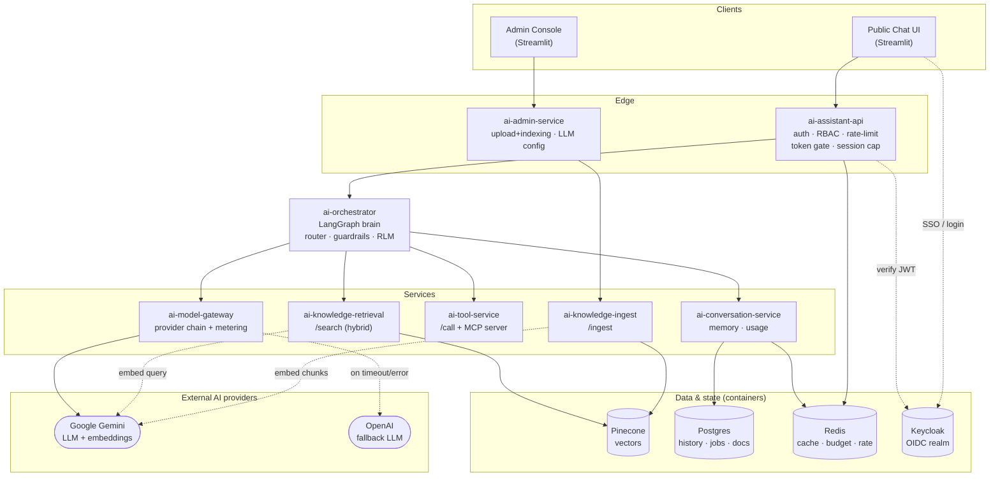
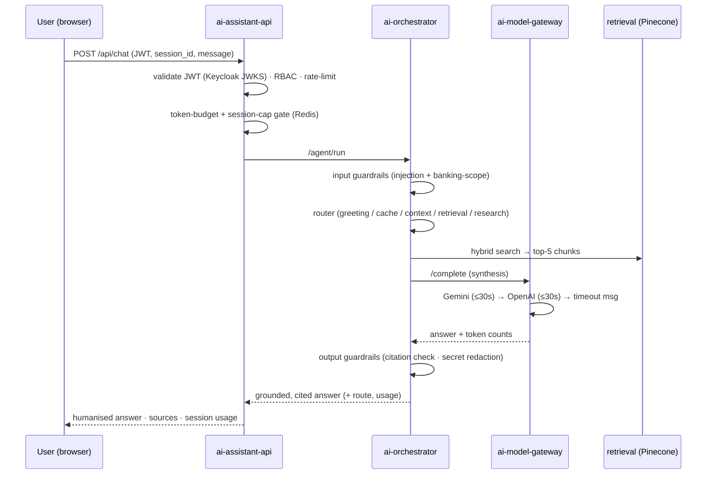
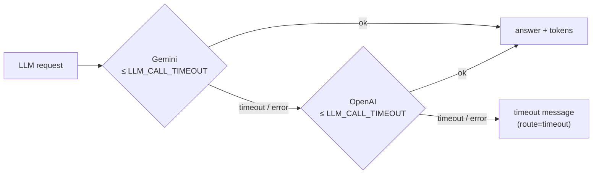

# Enterprise AI Assistant — ABC Bank (fictional)

> **AI Lead Technical Assessment** · Author: Lahiru · Role: AI Solution Architect / AI-ML Lead
> Status: **Running enterprise stack** — real Gemini LLM (+ OpenAI fallback), real Gemini
> embeddings, real Pinecone vector DB, real Keycloak OIDC, real Redis + Postgres, on Docker Compose.

An **agentic RAG** assistant over organizational knowledge, branded as **ABC Bank** (a *fictional*
bank — no real or sensitive data). It answers customer questions about banking products and services
(loans, deposits, cards, accounts, exchange rates, remittances, account opening) from an indexed
knowledge base, with retrieval-grounded, cited answers.

This is **not a thin wrapper around an LLM + vector DB.** It is a microservice **monorepo**
orchestrated with **LangGraph**, with a Recursive-Language-Model research flow, hybrid retrieval,
two web interfaces (public chat + admin console), RBAC, input/output guardrails, provider
fail-over, per-session token caps, and full observability.

## The stack is real by default

Out of the box (`.env` from `.env.example`), every dependency is a real backend — not a mock:

| Capability | Real implementation (default) | Configured by |
|---|---|---|
| **LLM** | **Google Gemini** for synthesis, routing, summarisation | `LLM_PROVIDER=gemini` + `GEMINI_API_KEY` |
| **LLM fail-over** | **OpenAI** when Gemini times out / errors | `LLM_FALLBACK=openai` + `OPENAI_API_KEY` |
| **Embeddings** | **Gemini `text-embedding-004`** — meaning-based dense vectors | `EMBEDDING_PROVIDER=gemini` |
| **Vector DB** | **Pinecone** (managed cloud, or local emulator container) | `PINECONE_API_KEY` / `PINECONE_HOST` |
| **Auth** | **Keycloak OIDC** — realm-as-code, SSO brokering + password grant | `AUTH_MODE=keycloak` |
| **Cache / budget / rate-limit** | **Redis** (local container) | `REDIS_URL` |
| **History / jobs / doc registry** | **Postgres** (local container) | `POSTGRES_DSN` |
| **Service-to-service** | **Real HTTP** between 9 services | `*_URL` (set by compose) |

> A dependency-free offline mode still exists for fast unit tests (mock LLM, hashing embedder,
> in-memory stores) — it activates only when the corresponding env vars are blank. The shipped
> configuration runs the real stack.

## High-level architecture



## Request flow (a chat question)



## Quick start (real stack)

**Prerequisites:** Docker + Docker Compose, a **Gemini API key** (Google AI Studio), and
optionally an **OpenAI key** (for LLM fail-over) and a **Pinecone key** (or use the local
emulator). Redis, Postgres and Keycloak run as containers — nothing to install.

```bash
cp .env.example .env
#  edit .env and set:
#    GEMINI_API_KEY=...        (required — real LLM + embeddings)
#    OPENAI_API_KEY=...        (optional — enables the OpenAI fallback)
#    PINECONE_API_KEY=...      (optional — omit to use the local Pinecone emulator below)

# full real stack (Gemini LLM/embeddings, Keycloak, Redis, Postgres, HTTP microservices)
docker compose up --build

# …or add the local Pinecone emulator (no Pinecone account needed)
docker compose -f docker-compose.yml -f docker-compose.pinecone.yml up --build
```

Then open the **public chat** at `http://localhost:8501` and the **admin console** at
`http://localhost:8502`. The banking knowledge base is auto-ingested on startup.

> Fast offline tests (no credentials): `make test` → **81 passing** (3 env-dependent skips).
> `make eval` → golden-set scorecard (Recall@k, citation integrity).

## Configure the LLM provider

Every model call funnels through `ai-model-gateway` → `libs/llm` (ADR-010), so the provider is
**configuration, not code**. The gateway runs an ordered chain with a per-provider timeout and
transparent fail-over:



```bash
# primary provider
LLM_PROVIDER=gemini
GEMINI_API_KEY=...                 # from Google AI Studio (keep ONLY in .env, never committed)
GEMINI_MODEL_STRONG=gemini-3.8-flash   # synthesis / validation
GEMINI_MODEL_FAST=gemini-3.8-flash     # routing / summarise

# fail-over provider (tried only if the primary times out or errors)
LLM_FALLBACK=openai
OPENAI_API_KEY=...                 # required, or the fallback degrades to a timeout message

# resilience knobs
LLM_CALL_TIMEOUT=30                # seconds per provider before switching to the next
MODEL_GATEWAY_HTTP_TIMEOUT=        # blank = auto (2*LLM_CALL_TIMEOUT + 15)
```

- `LLM_PROVIDER` accepts `gemini | anthropic | openai | mock`. Each adapter
  (`libs/llm/provider_gemini.py`, `provider_openai.py`, `provider_anthropic.py`) implements one
  method — `complete(system, user, model) -> Completion` — mapping the provider's text + token
  counts into the pipeline. Add any model by dropping in a new `provider_*.py` and registering it.
- **Every call is logged** in the gateway (`llm_request` / `llm_response` / `llm_timeout`) with
  provider, model and input/output token counts.
- **Runtime switch (no restart):** an Administrator can create and activate an LLM config from the
  admin console (provider + model slugs + API key). The gateway rebuilds live. The API key is
  **write-only** — accepted once, stored server-side, never returned or shown (list responses carry
  only a `has_secret` flag).

## User roles & functionalities

Three roles, enforced by the RBAC matrix + Policy Enforcement Point (`libs/authz`) and mapped from
Keycloak realm/client roles:

| | **Public / Viewer** | **Analyst** | **Administrator** |
|---|---|---|---|
| **Sign-in** | SSO / self-registration → **Viewer** (or `public / Public#12345`) | username + password (`analyst / Analyst#12345`) | username + password (`admin / Admin#12345`) |
| Ask the assistant (grounded, cited answers) | ✅ | ✅ | ✅ |
| Hybrid retrieval over the knowledge base | ✅ | ✅ | ✅ |
| Session memory + recent-conversations view | ✅ | ✅ | ✅ |
| Tools (web search, MCP directory, doc parser) | — | ✅ | ✅ |
| Deeper research (multi-step RLM) | — | ✅ | ✅ |
| Higher token budget | Viewer tier | Analyst tier | Admin tier |
| **Upload documents** (PDF/Word/Excel/MD/HTML/TXT) + live indexing progress | — | — | ✅ |
| **Configure the LLM provider** at runtime | — | — | ✅ |
| Run the evaluation scorecard | — | — | ✅ |

**Two login models by design.** Public users authenticate via **SSO / identity brokering** and are
granted **Viewer** automatically; staff (**Analyst**, **Administrator**) use **username/password**
(OIDC password grant). Both paths issue JWTs that the API validates against the Keycloak realm JWKS.

## Guardrails, resilience & limits

- **Input guardrails** — a prompt-**injection** screen *and* a **banking-scope** rail: off-domain
  questions (e.g. "write me a poem") are rejected at the input before any LLM or retrieval call,
  with a polite on-brand message (`libs/orchestrator/guardrails.py`).
- **Output guardrails** — citation integrity (no fabricated document IDs) and secret redaction.
- **Provider fail-over** — Gemini → OpenAI → timeout message, per-provider `LLM_CALL_TIMEOUT`.
- **Per-session token cap** — each chat is capped (`SESSION_TOKEN_CAP`, default **100,000**;
  `0` disables). On reaching it the user is asked to start a new chat; the UI shows a live token
  meter. Counts are tallied per session in Redis.
- **Per-user token budget** + **rate limiting** (Redis), pre-checked at the edge.
- **Graceful degradation** — no inference path returns a 500; upstream failures become friendly,
  logged, degraded answers.

## Knowledge base

The shipped corpus models a retail bank (ABC Bank) — 10 product/policy documents covering deposits
& rates, personal loans, home loans, leasing & gold, non-resident banking, forex & exchange rates,
business banking, investments, account-opening procedures, and cards
(`services/ai-knowledge-service/ingestion/sample_docs/`). Retrieval is **hybrid**: dense (Gemini
embeddings, by *meaning*) + BM25 (by *text*) → **RRF fusion** → rerank → access filter → **top-5**
chunks to the LLM.

## Project structure

```
AI_Assistant/
├── README.md  Makefile  docker-compose.yml  docker-compose.pinecone.yml
├── .env.example  pyproject.toml  conftest.py  pytest.ini
│
├── libs/                              # the ENGINE (shared by every service)
│   ├── contracts/     models.py · errors.py
│   ├── authz/         rbac.py · policy.py · identity.py       # roles, PEP, Keycloak/dev auth
│   ├── authclient/    keycloak_client.py                     # UI token acquisition (SSO + password)
│   ├── observability/ logging.py                             # structured JSON logs + correlation ids
│   ├── llm/           provider(+gemini/openai/anthropic) · gateway · config_store
│   ├── rag/           chunking · embeddings(+gemini/openai) · bm25 · vectorstore(+pinecone) · hybrid · ingest
│   ├── memory/        conversation · usage (user + session) · redis_client
│   ├── db/            engine · stores                        # Postgres (SQLAlchemy 2.0)
│   ├── clients/       services.py                            # HTTP clients (service-to-service)
│   ├── admin/         jobs · ingest_runner                   # upload jobs + staged indexing
│   └── orchestrator/  graph(+graph_langgraph) · ops · prompts · guardrails · tools · mcp_*
│
├── services/                         # thin FastAPI / Streamlit deployables
│   ├── ai-assistant-api/     chat edge: auth·RBAC·rate-limit·token+session gate·SSE
│   ├── ai-orchestrator/      /agent/run (LangGraph brain)
│   ├── ai-knowledge-service/ retrieval (/search) + ingestion (/ingest) + banking corpus
│   ├── ai-tool-service/      /call + real MCP server (stdio)
│   ├── ai-conversation-service/  /context · usage
│   ├── ai-model-gateway/     /complete (provider chain + fallback + metering)
│   ├── ai-admin-service/     doc upload+progress · runtime LLM config · eval
│   ├── ui-public/            Streamlit chat + SSO/staff login + token meter
│   └── ui-admin/             Streamlit admin console
│
├── infra/keycloak/abc-bank-realm.json   # realm-as-code: clients, roles, SSO broker, seeded users
├── tests/                            # 81 passing: unit · e2e · langgraph · tools · backends · auth · admin · llm-config · timeout/session · integration
├── docs/   00–20 design docs + ADRs 001–011
└── diagrams/  C4 (L1–L3), service map, LangGraph flow, RAG ingest/retrieve, deployment, eval (.drawio)
```

## Observability

Structured JSON logs with correlation IDs across every service; a live agent-activity event stream
in the UIs; and **LangSmith** tracing of LangGraph node transitions + LLM/retriever spans when
enabled:

```bash
LANGSMITH_TRACING=true
LANGSMITH_API_KEY=...
LANGSMITH_PROJECT=ai-assistant
```

## Validation

`make test` → **81 passing** offline (3 env-dependent skips); more with Redis+Postgres live.
`make eval` on the golden set → **Recall@k = 1.0, citation integrity = 1.0**. The architect ⇄
evaluator loop caught and fixed a real retrieval-precision bug (date/ID queries ranked the wrong
document until chunk-level metadata was indexed).

## Reading the design

Start with `docs/00-requirements-traceability.md`, `docs/13-service-topology.md`, and the teaching
walkthrough `docs/20-system-explained.md`. The full index (00–20 + ADRs 001–011) is in `docs/`, with
editable diagrams in `diagrams/`.
